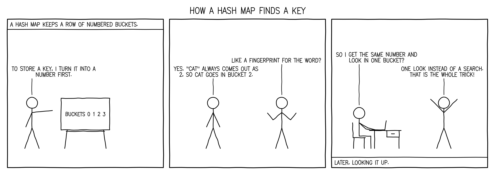

# Testing comic

How `comic` is tested, and what each run found. Newest first.

## 2026-11-05: the first version, on GraniteRust 7ef00cd



### The suite

`cargo test`: 46 tests, all passing.

| Crate | Tests | What they hold |
| --- | --- | --- |
| comic-core | 25 | the script read loosely and measured; the lettering; every pose inside its box; the layout's grid, bubbles and findings |
| comic-render | 12 | the CPU's bytes against a golden hash; the GPU against the CPU (max 1 level of 255 on an M4 Max); the PNG and its carried script |
| comic | 9 | the entry; a strip drawn again with no model, the same bytes twice and from its PNG; drafted and revised by a model; an unchanged revision ending the rounds; changed by a brief; every refusal by kind; the GPU or a `device` refusal; a call over the real wire |

### GraniteRust's check, on this Mac (`scripts/check.sh --native`)

Installed from this repository's last commit by GraniteRust's installer, then called as a host calls it:

```text
installed ComicAgent: comic · granite 0.1.0@7ef00cd35cfe976bda378e4054fc7aabbea60c07
valid: installation.json against granite-agent-installation.schema.json
valid: entry-0.json against granite-agent-entry.schema.json
note: drawing again from hashmap.comic.json
note: round 1: measured clean
note: drawing 3 panels on the gpu
note: wrote comics/how-a-hash-map-finds-a-key.png
released · peak 61 MB · 0.1 s CPU in 0.1 s
valid: redraw.perform.answer.json against granite-agent-answer.schema.json
valid: redraw.perform.answer.json against craft-agent-output.schema.json
redraw.perform: answered, comic how-a-hash-map-finds-a-key (written)
broken.refusal: refused (call): the script broken.comic.json could not be read: the script is not JSON …
nomodel.refusal: refused (call): comic drafts with the host's model and this host has none: give `script` …
panels.refusal: refused (input): `panels` is 9: a strip holds 1 to 6
valid: redraw.perform.answer.json against comic.answer.schema.json
valid: carried.comic.json against comic.schema.json
the strip is 3200x1130, drawn on the gpu, and carries its craft-comic/1 script
GPU against CPU: {"max":1,"over":0,"tolerance":3,"total":3616000}
```

### GraniteRust's check, in Apple's container (`scripts/check.sh`)

Apple `container` 1.6.1, Linux arm64. The first run's build was killed by memory at the container's default size
(rustc on wgpu's Vulkan bindings, `ash`); with 8 GB and 8 CPUs it builds. A Linux VM has no Metal, so the strip is
drawn on the CPU, and the answer says so with a `fallback` problem.

```text
installed ComicAgent: comic · granite 0.1.0@7ef00cd35cfe976bda378e4054fc7aabbea60c07
note: drawing 3 panels on the cpu
released · peak 30 MB · 0.0 s CPU in 0.0 s
redraw.perform: answered, comic how-a-hash-map-finds-a-key (written)
broken.refusal: refused (call) · nomodel.refusal: refused (call) · panels.refusal: refused (input)
the strip is 3200x1130, drawn on the cpu, and carries its craft-comic/1 script
comic: check passed (container)
```

### A Swift host: Granite's own `AgentProcess` (Granite 193a2d9)

The installed runner, called from Swift with a stand-in for the host's model that answers its one ask with the
fixture script:

```text
described: ["comic"] module ComicAgent makes ["comic"]
note: drafting the strip: panels, figures, what they say
note: round 1: measured clean
note: drawing 3 panels on the gpu
note: wrote comics/how-a-hash-map-finds-a-key.png
cost: released · peak 61 MB · 0.1 s CPU in 0.1 s · asks 1 · exit 0
refused: comic refused (input): `panels` is 9: a strip holds 1 to 6
refused: comic refused (call): comic drafts with the host's model and this host has none: …
```

### Craft, pointed at a shelf with this runner on it

`CRAFT_AGENTS_DIR=<shelf> craft agents` lists it with no change to Craft:

```text
comic         package  installed · ComicAgent  draws a stick-figure comic strip that explains a concept, as a PNG: …
                                               takes brief string, panels integer, script string, output string, rounds integer, seed integer, renderer gpu|cpu|auto
```

`craft agents schema comic --into Schema` wrote [`Schema/Comic.md`](Schema/Comic.md) and its two JSON Schemas from the
installed record.

### Not yet run

A live Craft turn (`explain how a hash map finds a key, as a comic $comic #canvas`) with Craft's own model drafting
the script: it was held back while another session was resetting Craft's thread. Run it with:

```bash
CRAFT_AGENTS_DIR=<shelf with ComicAgent> craft -p 'explain how a hash map finds a key, as a comic $comic' --cwd <scratch project>
```
